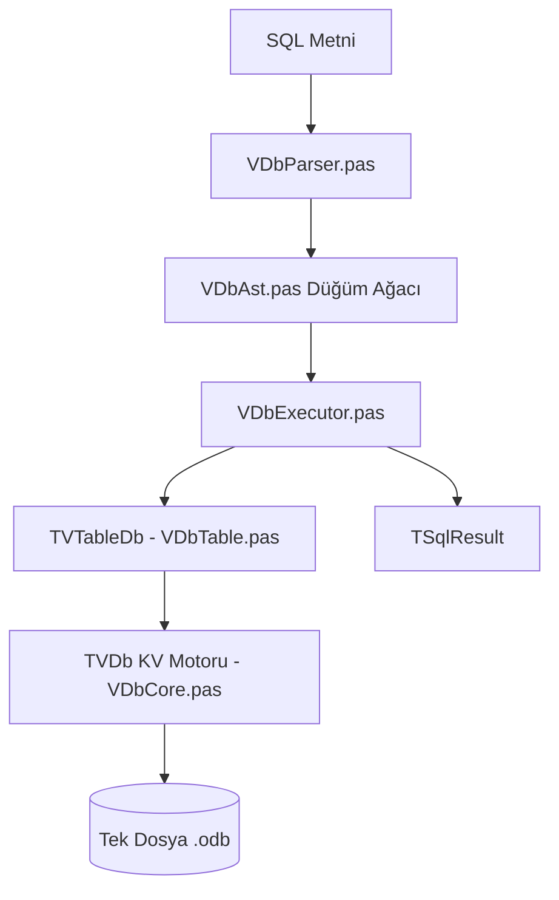

# VDb Veritabanı — Kapsamlı Uygulama Analizi ve Yol Haritası

**Tarih:** Ekim 2026  
**Durum:** AST Dönüşümü Tamamlandı — 288/288 Test Başarılı (%100 Yeşil)  
**Hedef:** VDb motorunun masaüstü (GUI), web servisi (REST API) ve kurumsal projelerde ana veritabanı olarak güvenle kullanılabilmesi için analiz ve yol haritası.

---

## 1. Yönetici Özeti ve Mevcut Durum

VDb, harici hiçbir DLL (SQLite vb.) veya C derleyicisi gerektirmeyen, **saf Free Pascal / Delphi** ile yazılmış, Bitcask tarzı eklemeli (append-only) tek dosyalı (`.odb`) ilişkisel bir veritabanı motorudur.

Gerçekleştirilen AST dönüşümü ile monolitik yapıdan kurtulmuş; **Ayrıştırıcı (VDbParser) → Tip-Güvenli Düğüm Modeli (VDbAst) → Yürütücü (VDbExecutor)** mimarisine geçmiştir.



### Temel Metrikler:
* **Test Başarısı:** `sqltest.exe` üzerinde 21 ana grupta **288 testin 288'i de geçerli (0 hata)**.
* **Arayüz Uyumluluğu:** `vdbgui.exe` ve `had.exe` yönetim araçları hatasız derlenip çalışmaktadır.
* **Veri Bütünlüğü:** CRC32 sağlama toplamı, işlem atomikliği (`VDB_FLAG_BATCHEND`), bozuk dosya sonunu otomatik budama (crash recovery).

---

## 2. VDb'nin Güçlü Yönleri (Neleri Çok İyi Yapıyor?)

1. **Sıfır Kurulum & Taşınabilirlik:** Uygulamanın yanında bağımlılık taşıma derdi yoktur; doğrudan çalıştırılabilir (.exe) içine gömülür.
2. **Kompakt Tek Dosya Mimarisi:** Tablo tanımları, indeksler, kısıtlar ve satırlar tek bir `<veritabani>.odb` içinde güvenle barındırılır.
3. **Eksiksiz İlişkisel Bütünlük:**
   - Birincil anahtar (PK), `NOT NULL`, `UNIQUE`, `CHECK` ifadeleri.
   - İki aşamalı Foreign Key motoru (`CASCADE`, `SET NULL`, `SET DEFAULT`, `RESTRICT`).
4. **Zengin SQL Desteği:**
   - `SELECT`, `INSERT`, `UPDATE`, `DELETE`.
   - `GROUP BY`, `HAVING`, `COUNT / SUM / AVG / MIN / MAX`.
   - `INNER JOIN` ve `LEFT JOIN` (tablo ve kolon alias desteği ile).
   - Küme işlemleri: `UNION`, `UNION ALL`, `EXCEPT`, `INTERSECT`.
   - Atomik çoklu kayıt: `INSERT INTO t VALUES (1),(2),(3)` ve `INSERT INTO t SELECT ...`.
   - Dinamik şema: `ALTER TABLE` (kolon ekle/çıkar/değiştir, tip dönüştür, varsayılan değer ver).
   - İşlemler: `BEGIN`, `COMMIT`, `ROLLBACK` (DDL geri alma dahil).
   - JSON Entegrasyonu: `EXPORT JSON` ve `IMPORT JSON`.

---

## 3. Gerçek Dünya Uygulamalarında Kullanım İçin Kritik Eksikler

VDb'yi gerçek bir projede kullanmak istediğinizde karşılaşacağınız yapısal eksikler 6 ana başlıkta toplanmıştır:

### 🚨 1. `TDataSet` / `TDataSource` Desteğinin Olmaması (En Kritik GUI Eksikliği)
* **Sorun:** Delphi ve Lazarus dünyasında standart arayüz bileşenleri (`TDBGrid`, `TDBEdit`, `TDBNavigator`, `TDBLookupComboBox` ve FastReport vb.) veriyle `TDataSet` üzerinden konuşur.
* **Mevcut Durum:** `TVSql.Exec` yalnızca metin tabanlı `TSqlResult` (sütun ve satır dizisi) döndürür.
* **Sonuç:** Kullanıcı arayüzünde veriyi göstermek için `TStringGrid` kullanıp satırları döngüyle tek tek kopyalamak zorunda kalırsınız; veri bağlama (Data Binding) çalışmaz.

### 🚨 2. Eşzamanlılık ve Çoklu İş Parçacığı (Multi-Threading) Sınırlamaları
* **Sorun:** [VDbSync.pas](file:///d:/veritabani/VDbSync.pas) dosya seviyesinde kilitleme yapar (`LockFileEx` / `flock`). Bir veritabanı dosyası açıkken başka bir süreç dosyayı açamaz.
* **Mevcut Durum:** Tek bir süreç içinde bile olsa, arka plan thread'leri (örneğin REST API sunucusuna gelen eşzamanlı HTTP istekleri) aynı `TVTableDb` örneğine yazıp okuduğunda bellek yarışması (race condition) doğar; çünkü motor dahili olarak thread-safe değildir.
* **İhtiyaç:** 
  - Çoklu okuyucu - tek yazıcı kilidi (**Reader-Writer Lock** - `TMultiReadExclusiveWriteSynchronizer`).
  - Web/API mimarileri için hafif bir **Bağlantı Havuzu (Connection Pool)**.

### 🚨 3. Her Şeyin "Metin (String)" Olarak Dolaşması
* **Sorun:** Tabloda `INTEGER`, `FLOAT`, `BOOL`, `DATE` tanımlı olsa da, `TSqlResult.Rows[i][j]` her değeri Pascal `string` olarak döndürür.
* **Sonuç:** 
  - 100.000 satırlık bir sorguda yüz binlerce minik `string` nesnesi bellekte fragmentasyona (parçalanmaya) yol açar.
  - Uygulama tarafında her sayısal alan için sürekli `StrToInt` veya `StrToFloat` yapmak gerekir.
  - `BLOB` (ikili resim/belge) saklandığında null-byte karakterleri metin üzerinden güvenle taşınamaz.

### 🚨 4. SQL Seviyesindeki İleri Özellikler
1. **Alt Sorgular (Subqueries):** `WHERE id IN (SELECT kisi_id FROM siparis)` veya `SELECT ad, (SELECT COUNT(*) FROM ...) FROM t` henüz desteklenmemektedir.
2. **3+ Tablo JOIN:** Mimari şu anda en fazla 2 tabloyu (`A JOIN B`) birleştirebilir; 3 veya daha fazla tablo zincirleme JOIN yapılamaz.
3. **Koşullu İfadeler:** `CASE WHEN ... THEN ... ELSE ... END` sözdizimi eksiktir.
4. **Türkçe / UTF-8 Sıralama ve Harf Eşleme (Collation):** `UPPER`, `LOWER` ve `ORDER BY` işlemleri sistemin yerel ASCII kodlamasına bağımlıdır; Türkçe `ı/I, i/İ, ş, ğ` karakterlerinde harf duyarsız arama için UTF-8 normalize fonksiyonu gereklidir.

### 🚨 5. Programatik Hata Yönetimi (Hata Kodları Eksikliği)
* **Sorun:** Hatalar doğrudan `Exception.Create('CHECK ihlali: ...')` gibi serbest metinlerle fırlatılmaktadır.
* **Sonuç:** Uygulama geliştiricisi `try..except` bloğunda hatanın tipini (örneğin mükerrer anahtar mı, yabancı anahtar ihlali mi, bağlantı kopması mı) anlayabilmek için metin ayrıştırmak (`Pos('UNIQUE', E.Message) > 0`) zorunda kalır.

### 🚨 6. `VDbSql.pas` İçindeki Ölü Kod Fazlalığı
* AST hattına geçildiği için [VDbSql.pas](file:///d:/veritabani/VDbSql.pas) içindeki eski monolitik `ExecRaw` bloğu (~1300 satır) atıl kalmıştır. Burası temizlenerek `VDbSql.pas` çok yalın bir "Dış Cephe (Facade)" haline getirilmelidir.

---

## 4. Uygulamalarınızda Kullanmak İçin Yapılması Gerekenler (Yol Haritası)

Aşağıdaki 4 aşamalı plan tamamlandığında VDb, masaüstü veya servis projelerinizde SQLite'ın yerini %100 alabilir hale gelecektir:

```
┌────────────────────────────────────────────────────────┐
│ Aşama 1: Temizlik, Hata Kodları ve Tipli Değer Modeli │
└──────────────────────────┬─────────────────────────────┘
                           ▼
┌────────────────────────────────────────────────────────┐
│ Aşama 2: TVDbDataSet Bileşeni (Lazarus / Delphi UI)    │
└──────────────────────────┬─────────────────────────────┘
                           ▼
┌────────────────────────────────────────────────────────┐
│ Aşama 3: Eşzamanlılık (Multi-Read Thread-Safety & Pool)│
└──────────────────────────┬─────────────────────────────┘
                           ▼
┌────────────────────────────────────────────────────────┐
│ Aşama 4: İleri SQL (Subquery, 3+ Tablo JOIN, CASE)     │
└────────────────────────────────────────────────────────┘
```

---

### Adım 1: Hata Kodları ve Tipli Değer Sistemi (1-2 Gün)

#### 1.1 `EVDbException` Sınıfı
```pascal
type
  TVDbErrorCode = (
    ecNone,
    ecTableNotFound,
    ecColumnNotFound,
    ecDuplicatePrimaryKey,
    ecUniqueViolation,
    ecNotNullViolation,
    ecCheckViolation,
    ecForeignKeyViolation,
    ecSyntaxError,
    ecDatabaseLocked
  );

  EVDbException = class(Exception)
  public
    ErrorCode: TVDbErrorCode;
    constructor Create(ACode: TVDbErrorCode; const AMsg: string);
  end;
```

#### 1.2 `VDbSql.pas` Dosyasının Sadeleştirilmesi
`ExecRaw` içindeki eski monolitik yollar silinmeli, sadece doğrudan `TVDbParser` ve `TVSqlExecutor` çağrısı bırakılarak dosya boyutu 4400 satırdan ~300 satıra düşürülmelidir.

---

### Adım 2: `TVDbDataSet` ve UI Veri Bağlama (2-3 Gün) ⭐ En Kritik Adım

Lazarus/Delphi `TDataSet` sınıfından türetilen `TVDbDataSet` oluşturulur.

#### Örnek Tasarım:
```pascal
unit VDbDataSet;

interface

uses
  Classes, SysUtils, DB, VDbTable, VDbSql, VDbAst;

type
  TVDbQuery = class(TDataSet)
  private
    FSqlEngine: TVSql;
    FSQL: TStrings;
    FCurrentRow: Integer;
    FLastResult: TSqlResult;
    procedure SetSQL(AValue: TStrings);
  protected
    function AllocRecordBuffer: TRecordBuffer; override;
    procedure FreeRecordBuffer(var Buffer: TRecordBuffer); override;
    procedure InternalInitFieldDefs; override;
    procedure InternalOpen; override;
    procedure InternalClose; override;
    function IsCursorOpen: Boolean; override;
    function GetRecord(Buffer: TRecordBuffer; GetMode: TGetMode; DoCheck: Boolean): TGetResult; override;
    function GetRecordCount: Integer; override;
  public
    constructor Create(AOwner: TComponent); override;
    destructor Destroy; override;
    property SQL: TStrings read FSQL write SetSQL;
    property SqlEngine: TVSql read FSqlEngine write FSqlEngine;
  end;
```

#### Kullanım Şekli:
```pascal
var
  Qry: TVDbQuery;
begin
  Qry := TVDbQuery.Create(Self);
  Qry.SqlEngine := GlobalSqlEngine;
  Qry.SQL.Text := 'SELECT id, ad, maas FROM personel WHERE aktif = 1';
  Qry.Open;

  // DBGrid ve Standart Veri Bileşenlerine Doğrudan Bağlanır:
  DataSource1.DataSet := Qry;
  DBGrid1.DataSource := DataSource1;
end;
```

---

### Adım 3: Eşzamanlılık (Multi-Threading & Sunucu Desteği) (2 Gün)

Birden çok thread'in aynı anda veritabanından veri okuyabilmesi (SELECT) ve yazma işlemi (INSERT/UPDATE/DELETE) geldiğinde güvenli biçimde sıraya girmesi için `TVTableDb` içine kilit yöneticisi eklenir:

```pascal
type
  TVDbLockManager = class
  private
    FLock: TMultiReadExclusiveWriteSynchronizer;
  public
    constructor Create;
    destructor Destroy; override;
    procedure BeginRead;   // SELECT başlarken
    procedure EndRead;     // SELECT bitince
    procedure BeginWrite;  // INSERT/UPDATE/DELETE/DDL başlarken
    procedure EndWrite;    // İşlem bitince
  end;
```

Bu sayede:
- 100 farklı istemci aynı anda `SELECT` sorgusu çalıştırabilir (maksimum CPU/disk paralelliği).
- Yazma isteği geldiğinde güvenle tekil kilit (`ExclusiveWrite`) alınır, işlem bitince okumalar devam eder.

---

### Adım 4: İleri Düzey SQL Yetenekleri (İhtiyaca Göre)

> **DURUM (2026-10-06):** Bu alt üç madde (3+ tablo JOIN, alt sorgu,
> CASE-WHEN) **onceden tamamlanmis** — bu dokuman bayatti. Guncel is,
> SQL.md "Desteklenmeyenler (bilerek yok)" listesindeki **gercek
> bosluklarin** sirayla acilmasi: **4.1 `CROSS JOIN` BITTI** ve **4.2
> `JOIN` + `GROUP BY`/aggregate BITTI** (2026-10-06; 982/982 + iki mutasyon
> kaniti; ayrica proje kokundeki bayat `.ppu` nedeniyle `mtakipwebsrv`
> link hatasinin **kok nedni** bulunup kalici cozuldu — bkz.
> `DENETIM_VE_YOL_HARITASI.md` → *ILERI SQL — ADIM 4*). Sira: HAVING
> aggregate, NOT/OR (DNF), WITH+DML, ROWS/RANGE, iliskili alt sorgu,
> VIEW (DML ✅ BITTI), PRAGMA.

1. **3+ Tablo JOIN:**
   - [VDbAst.pas](file:///d:/veritabani/VDbAst.pas) içindeki `Join: TJoinClause` tekil kaydı yerine `Joins: TList<TJoinClause>` liste yapısına geçilir.
   - `ExecJoinScan` özyinelemeli (nested loop) hale getirilerek sınırsız tablo bağlanabilir.
2. **Alt Sorgular (Subquery):**
   - AST'ye `TSqlSubqueryNode = class(TSqlExprNode)` düğümü eklenir.
   - `WHERE id IN (SELECT ...)` ifadesi yürütülürken önce içteki SELECT çalıştırılıp geçici sonuç kümesi oluşturulur.
3. **CASE-WHEN İfadeleri:**
   - AST'ye `TSqlCaseNode` eklenerek `CASE WHEN x=1 THEN 'A' ELSE 'B' END` raporlama sorguları açılır.

---

## 5. Projelerinizde Hemen Kullanmak İçin Örnek Şablon

Mevcut haliyle bile VDb'yi arka plan işlemlerinde veya basit masaüstü uygulamalarında şu şekilde hemen kullanabilirsiniz:

```pascal
program Projem;

uses
  SysUtils, VDbCore, VDbTable, VDbSql;

var
  Kv: TVDb;
  TableDb: TVTableDb;
  Sql: TVSql;
  Res: TSqlResult;
  i: Integer;
begin
  // Dogru acilis sirasi (TVDb.Open YOK; Tb.Open SART - semayi yukler):
  Kv := TVDb.Create;
  TableDb := TVTableDb.Create(Kv);
  Sql := TVSql.Create(TableDb);
  try
    Kv.Open('db');       // veri klasoru
    TableDb.Open('db');  // atlanirsa mevcut tablolar gorunmez ("tablo yok")
    // 2. Tablo oluştur
    Sql.Exec('CREATE TABLE IF NOT EXISTS urunler (' +
             '  id INTEGER PRIMARY KEY AUTOINCREMENT,' +
             '  kod TEXT UNIQUE NOT NULL,' +
             '  fiyat FLOAT DEFAULT 0.0' +
             ')');

    // 3. Parametreli güvenli kayıt ekleme
    Sql.Exec('INSERT INTO urunler (kod, fiyat) VALUES (?, ?)', ['ELMA-01', '35.50']);
    Sql.Exec('INSERT INTO urunler (kod, fiyat) VALUES (?, ?)', ['ARMUT-02', '42.00']);

    // 4. Sorgula ve listele
    Res := Sql.Exec('SELECT id, kod, fiyat FROM urunler ORDER BY fiyat DESC');
    WriteLn('Toplam Satır: ', Length(Res.Rows));
    for i := 0 to High(Res.Rows) do
      WriteLn(Format('ID: %s | Kod: %s | Fiyat: %s TL', [Res.Rows[i][0], Res.Rows[i][1], Res.Rows[i][2]]));

  finally
    Sql.Free;
    TableDb.Free;
    Kv.Free;
  end;
end.
```

---

## 6. Sonuç

VDb'nin çekirdek motoru ve SQL ayrıştırma/çalıştırma omurgası **başarılı bir şekilde tamamlanmış, kararlı ve sağlam durumdadır**. 

Uygulamalarınızda en verimli şekilde kullanabilmeniz için sıradaki **en öncelikli adım: `TVDbDataSet` bileşeninin yazılmasıdır**. Bu adım tamamlandığında, projelerinizde hiçbir kod değişikliği yapmadan doğrudan görsel bileşenlerle (`DBGrid`, `DBEdit` vb.) VDb'nin gücünden faydalanabilirsiniz.
