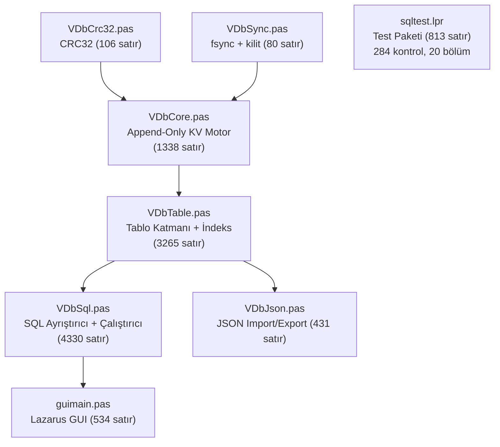

# VDb Veritabanı Motoru — Derinlemesine Kod İnceleme Raporu

> Satır satır incelenen dosyalar: `VDbCrc32.pas`, `VDbSync.pas`, `VDbCore.pas`, `VDbTable.pas`, `VDbSql.pas`, `VDbJson.pas`, `guimain.pas`, `sqltest.lpr`, `README.md`, `SQL.md`

---

## 1. Mimari Değerlendirme (Büyük Resim)



Katmanlama **çok temiz**. Her unit tam olarak bir iş yapıyor ve bağımlılıklar yukarıdan aşağıya tek yönlü. Bu, saf Pascal'da yazılmış ticari düzeyde bir veritabanı motoru için mükemmel bir mimari.

---

## 2. Dosya Bazlı Detaylı İnceleme

### 2.1 [`VDbCrc32.pas`](file:///D:/veritabani/VDbCrc32.pas) — ✅ Kusursuz

| Konu | Değerlendirme |
|---|---|
| Doğruluk | IEEE 802.3 poly `$EDB88320`, doğrulama değerleri doğru |
| Güvenilirlik | Slice-by-4/8 FPC 3.2.4'te tutarsız → bilerek kapatılmış, doğru karar |
| Performans | Byte-by-byte yeterli (CRC motoru değil, bütünlük kontrolü) |
| API | `Init/Update/Final` + `OfBytes` + `UpdatePtr` — tüm senaryolar kapsanmış |

> [!NOTE]
> Tablo `T0` bir kez `BuildTbl` ile oluşturuluyor, ama **thread-safe değil**. `TblOk` kontrolü yarış durumu (race condition) içerir. İki thread aynı anda ilk CRC çağrısını yaparsa tablo yarım kurulabilir. Proje tek-thread olduğu için şu an sorun değil, ama V2 multi-thread okumaya geçildiğinde bu bir `initialization` bloğuna taşınmalı:
> ```pascal
> initialization
>   BuildTbl;
> ```

---

### 2.2 [`VDbSync.pas`](file:///D:/veritabani/VDbSync.pas) — ✅ Sağlam

| Konu | Değerlendirme |
|---|---|
| `FlushFileBuffers` (Windows) | ✅ Doğru — OS buffer'ını diske yazar |
| `FpFsync` (Unix) | ✅ Doğru |
| `LockFileEx` + `LOCKFILE_FAIL_IMMEDIATELY` | ✅ Bloklamayan, exclusive kilit |
| `FpFlock` (Unix) | ✅ `LOCK_EX + LOCK_NB` |

> [!WARNING]
> **Dizin fsync'i eksik.** Dosya yeniden adlandırma (`RenameFile`) sonrasında yalnızca dosyanın içeriği fsync edilmiş, **dizin girişi** fsync edilmemiş. Güç kesintisinde rename işlemi dizin metadatasında kaybolabilir. Bu, çoğu gömülü veritabanının (SQLite dahil) bilinen bir sorunudur. Çözüm:
> ```pascal
> procedure VDbFlushDir(const DirPath: string);
> // Unix: klasörü O_RDONLY aç, fsync yap, kapat
> // Windows: FlushFileBuffers dizin için gerekli değil (NTFS journal'ı halleder)
> ```
> Pratikte Windows NTFS'te sorun olmaz, ama Linux ext4 hedefleniyorsa gereklidir.

---

### 2.3 [`VDbCore.pas`](file:///D:/veritabani/VDbCore.pas) — ✅ Çok İyi (birkaç dikkat noktası)

#### Güçlü Yönler
- **BATCHEND protokolü** atomik commit sağlıyor — kayıt formatı basit ve doğru
- **Recovery** yırtık kuyruk tespiti + legacy dosya desteği sağlam
- **FPutSeen optimizasyonu** batch'te O(n²) → O(n) — akıllı çözüm
- **PendingIdx haritası** batch-içi okumayı O(1)'e indiriyor
- **Dosya sürüm kontrolü** V1→V2 geçişi ile eski build'in veri kaybetmesi engelleniyor

#### Dikkat Noktaları

> [!IMPORTANT]
> **1. `Verify` tüm dosyayı RAM'e okuyor** ([satır 1181](file:///D:/veritabani/VDbCore.pas#L1181)):
> ```pascal
> SetLength(buf, fsize);
> FS.ReadBuffer(buf[0], fsize);
> ```
> 500MB+ dosyada OutOfMemoryError verir. `ScanAll` 64KB blok tampona geçmiş ama `Verify` hâlâ tek parça okuyor. Bloklu okumaya geçmeli.

> [!IMPORTANT]
> **2. `Compact` sırasında ScanAll tüm canlı veriyi RAM'de tutuyor** ([satır 1040](file:///D:/veritabani/VDbCore.pas#L1040)):
> ```pascal
> ScanAll(keys, vals);
> ```
> Ardından hepsini yeni dosyaya yazıyor. 100K satırlık tabloda sorun olmaz ama 1M+ satırda hem RAM hem de süre problemi olur. Çözüm: dosyayı kayıt kayıt tarayıp "canlı mı?" kontrolüyle doğrudan hedef dosyaya yazmak (streaming compact).

> [!NOTE]
> **3. `DeadBytes` tahmini** — `AppendRec` içinde eski kaydın boyutuna header boyutunu ekliyor ([satır 432](file:///D:/veritabani/VDbCore.pas#L432)). Bu doğru, ama `Recover` sırasında ölü byte hesabı yapılmıyor — yalnızca canlı kayıtlar indexleniyor. Yani veritabanı yeniden açıldığında `DeadBytes = 0` oluyor ve `AutoCompact` ilk oturumda tetiklenmiyor. (İkinci oturumda yazma yapılınca yeniden birikir.)

> [!TIP]
> **4. `MigrateLegacy` tüm dosyayı RAM'e alıyor** ([satır 290](file:///D:/veritabani/VDbCore.pas#L290)). ScanAll gibi bloklu yaklaşıma geçilebilir, ama legacy dosya zaten bir kere okunacağı için kritik değil.

---

### 2.4 [`VDbTable.pas`](file:///D:/veritabani/VDbTable.pas) — ✅ İyi (en hacimli ve karmaşık unit)

#### Güçlü Yönler
- **Tembel (lazy) indeks kurulumu** → açılış süresi ~0ms (ilk sorguda kurulur)
- **İndeks tampon katmanı** (FIdxOps → flush → sıralı FMemIdx) mükerrer giriş sorununu çözmüş
- **FK iki aşamalı denetim** — önce tüm RESTRICT'ler, sonra kaskadlar: tablonun iterate sırasına bağımlı yan etki yok
- **Şema ezilmesi koruması (GuardSchemaLoss)** — gerçek bir veri kaybı olayından öğrenilmiş, savunma kodlanmış
- **ROLLBACK DDL dahil** — SnapshotSchema/RestoreSchemaSnapshot ile CREATE/DROP TABLE bile geri alınıyor
- **VDbHashKey → FNV-1a 64-bit** — çarpışma olasılığı düşük, sonuç 0 ise 1 yapılıyor (0 = şema key)

#### Dikkat Noktaları

> [!WARNING]
> **1. Hash çarpışması sessiz veri kaybına yol açar.** `VDbHashKey` FNV-1a 64-bit kullanıyor. Farklı `(table, pk)` çiftlerinin aynı hash'i üretme olasılığı çok düşük ama sıfır değil. Çarpışma olursa eski satır sessizce yeni satırla **ezilir** — hiçbir hata verilmez. Çözüm: `DecodeRow` sırasında okunan kaydın table+pk'sının bekleneniyle eşleştiğini doğrulamak (`Get` bunu Magic + Key ile yapıyor ama tablo+pk seviyesinde değil).

> [!NOTE]
> **2. `CheckConstraints` indeks yokken tam tarama yapıyor** ([satır 1573](file:///D:/veritabani/VDbTable.pas#L1573)). UNIQUE kontrolü için her INSERT'te `ScanRows` çağrılıyor. Bu O(n) ve 100K satırlık tabloda yavaşlar. Çözüm: UNIQUE kolon için otomatik indeks oluşturmak (birçok RDBMS bunu yapar).

> [!NOTE]
> **3. `FindCol` lineer arama** ([satır 1534](file:///D:/veritabani/VDbTable.pas#L1534)). Tablo tanımındaki kolon sayısı genellikle <50 olduğu için sorun değil, ama sık çağrılan yerlerde (FK denetimi, WHERE çözümleme) toplamda etkili olabilir.

---

### 2.5 [`VDbSql.pas`](file:///D:/veritabani/VDbSql.pas) — ✅ İyi ama En Riskli Unit

4330 satır tek dosyada — hem tokenizer, hem parser, hem executor. Bu projedeki **en büyük teknik borç** burası.

#### Güçlü Yönler
- **Tokenizer** tırnak kaçışı (`''`), parametre yer tutucusu (`?`), operatör tokenları doğru handle ediyor
- **WHERE parser** recursive-descent ile AND/OR öncelikli, parantez destekli DNF çözüyor
- **NOT işlemi** De Morgan uyumsuzluğunu kullanıcıya açık hata mesajıyla bildiriyor — sessiz yanlış sonuç yerine hata vermek doğru
- **QuickSortIntKeys** önceden hesaplanmış Int64 anahtarla ~6x hızlanma
- **UNION/EXCEPT/INTERSECT** + kuyruk ORDER BY/LIMIT
- **Otomatik transaction** — batch-uyumsuz komutları (DDL, VACUUM, IMPORT) otomatik olarak dışarıda bırakıyor
- **StmtBatchSafe** kontrolü akıllıca tasarlanmış

#### Sorunlar ve Öneriler

> [!CAUTION]
> **1. Tokenizer `;` karakterini boşluk gibi atlıyor** ([satır 198](file:///D:/veritabani/VDbSql.pas#L198) ve [satır 217](file:///D:/veritabani/VDbSql.pas#L217)):
> ```pascal
> while (P <= Length(S)) and (S[P] in [' ', #9, #10, #13, ';']) do Inc(P);
> ```
> Bu, `ExecRaw` tek bir cümle çalıştırırken sorun olmaz çünkü `SplitStatements` zaten `;` ile ayırmış. Ama `ExecRaw` doğrudan çağrılırsa, `;` sonrası kalan metin **sessizce atlanır**. API düzeyinde sorun yok (dış çağrıcı her zaman `Exec` → `SplitStatements` → `ExecAll` kullanıyor), ama savunmacı programlama açısından riski belirtmek gerekir.

> [!WARNING]
> **2. `IndexOfRow` ve `DedupRows` O(n²)** ([satır 710-932](file:///D:/veritabani/VDbSql.pas#L710-L932)). UNION/EXCEPT/INTERSECT ve SELECT DISTINCT için satır satır doğrusal arama yapılıyor. 10K+ satır birleşiminde yavaşlar. Hash-set tabanlı lookup ile O(n)'e indirilebilir.

> [!WARNING]
> **3. `ApplySetTail` içindeki sıralama insertion sort** ([satır 887-901](file:///D:/veritabani/VDbSql.pas#L887-L901)). UNION sonrası ORDER BY'da satır sayısı büyükse O(n²). Mevcut QuickSort fonksiyonu (`QuickSortIdx`) burada da kullanılabilir.

> [!IMPORTANT]
> **4. Parser + Executor ayrımı yok.** `ExecRaw` metodu ~2000 satır uzunluğundadır ve SQL metnini tokenize ederken aynı anda çalıştırıyor. Bu yapı şu sorunları doğurur:
> - Yeni SQL özelliği eklemek (subquery, CTE) riskli — yan etkileri test etmek zor
> - Query plan optimizasyonu eklenemez (ne çalıştıracağını bilmeden çalıştırıyor)
> - Hata mesajları bazen bağlamdan kopuk
>
> **V2 için öneri:** `TVSqlNode` (AST düğümü) hiyerarşisi → `Parse(sql): TNode` → `Execute(node): TSqlResult`

---

### 2.6 [`VDbJson.pas`](file:///D:/veritabani/VDbJson.pas) — ✅ Temiz

| Konu | Değerlendirme |
|---|---|
| Export | Kanonik sıra (tablo adı + PK), deterministik çıktı ✅ |
| Import | FK bağımlılık sırası (topolojik sıralama) ✅ |
| Atomiklik | 5000 satırda ara commit — büyük veri için mantıklı |
| Encoding | `UTF8Decode` + `AnsiString` fpjson uyumu doğru |

> [!NOTE]
> **Export sırasında FK aksiyonları (`OnDelete`/`OnUpdate`) JSON'a yazılmıyor** ([satır 187-189](file:///D:/veritabani/VDbJson.pas#L187-L189)). Yalnızca `col`, `reftable`, `refcol` var. Import sonrası tüm FK'lar varsayılan `RESTRICT` olur. Bu, `CASCADE` veya `SET NULL` kullanan tabloların export/import döngüsünde davranış değişikliğine yol açar.

---

### 2.7 [`guimain.pas`](file:///D:/veritabani/guimain.pas) — ✅ Fonksiyonel

- Açılışta otomatik `Verify` + durum çubuğunda `SAĞLAM` bildirimi ✅
- Tarih damgalı yedek alma ✅
- `SyncWrite = False` + otomatik transaction (hız + güvenlik dengesi) ✅

> [!TIP]
> **Hata durumunda `FOpen` durumu tutarsız kalabilir** ([satır 155](file:///D:/veritabani/guimain.pas#L155)): `FOpen := True` satırı iki kez var (137 ve 155). İlki `Verify` öncesinde, ikincisi sonrasında. Verify hata verirse `FOpen` zaten `True` kalmış oluyor — sorun değil ama gereksiz tekrar.

---

### 2.8 [`sqltest.lpr`](file:///D:/veritabani/sqltest.lpr) — ✅ Kapsamlı

284 kontrol, 20 bölüm — veri tipleri, kısıtlar, FK, JOIN, UNION, ALTER, transaction, otomatik transaction, veritabanı komutları... hepsi test edilmiş. Bu düzeyde test kapsamı olan hobi projeleri **çok nadirdir.**

---

## 3. Kritik Bulgular Özet Tablosu

| # | Öncelik | Konum | Bulgu | Çözüm |
|---|---|---|---|---|
| 1 | 🔴 Yüksek | `VDbCore.Verify` | Tüm dosyayı RAM'e okuyor — büyük dosyada OOM | Bloklu okuma |
| 2 | 🔴 Yüksek | `VDbTable.VDbHashKey` | Hash çarpışması sessiz veri ezme | Satır okunurken table+pk doğrula |
| 3 | 🟡 Orta | `VDbJson` export | FK aksiyonları (CASCADE vb.) JSON'a yazılmıyor | `ondelete`/`onupdate` alanları ekle |
| 4 | 🟡 Orta | `VDbSql.DedupRows` | DISTINCT/UNION O(n²) | Hash-set tabanlı lookup |
| 5 | 🟡 Orta | `VDbCore.Compact` | Tüm canlı veriyi RAM'de tutuyor | Streaming compact |
| 6 | 🟡 Orta | `VDbCore.Recover` | `DeadBytes` yeniden açılışta sıfırlanıyor | Recover sırasında ölü byte hesapla |
| 7 | 🟢 Düşük | `VDbCrc32` | `BuildTbl` thread-safe değil | `initialization` bloğuna taşı |
| 8 | 🟢 Düşük | `VDbSync` | Dizin fsync'i yok (Linux ext4 riski) | `VDbFlushDir` ekle |
| 9 | 🟢 Düşük | `VDbTable.CheckConstraints` | İndekssiz UNIQUE kontrolü tam tarama | UNIQUE için otomatik indeks |

---

## 4. V2 Yol Haritası İçin Mimari Öneriler

### 4.1 AST Tabanlı SQL Pipeline (En Önemli)
```
SQL metin → Tokenizer → Parser → AST → Optimizer → Executor → Sonuç
```
Şu an: `SQL metin → Tokenize+Parse+Execute (iç içe)`. Subquery ve CTE eklemek için AST şart.

### 4.2 WAL vs Append-Only Kararı
Mevcut append-only yapı **çoklu okuyucu** için doğal olarak uygun. WAL (Write-Ahead Log) ile update-in-place'e geçmek tamamen farklı bir motor demek. İki alternatif:

| Yol | Avantaj | Dezavantaj |
|---|---|---|
| **A) Append-only + Page** | Mevcut kodun %80'i korunur, okuma kilidi kolay | Büyük dosyada compact gerekli |
| **B) WAL + B-Tree (SQLite tarzı)** | Endüstri standardı, çoklu okuyucu yerleşik | Motor sıfırdan yazılır |

**Önerim: Yol A** — mevcut güçlü temeli korur.

### 4.3 Öncelik Sıralaması
1. `Verify`/`Compact`'ın RAM limitini kaldır (streaming)
2. JSON export'a FK aksiyonlarını ekle
3. Hash çarpışma koruması (okumada doğrulama)
4. SQL parser'ı AST'ye çevir (yeni dosya: `VDbAst.pas`)
5. Subquery desteği
6. CTE desteği
7. Paylasimli okuma kilidi (RCU)

---

## 5. Genel Puan

| Kriter | Puan | Yorum |
|---|---|---|
| **Kod Kalitesi** | 9/10 | Yorumlar, hata mesajları, savunmacı kodlama mükemmel |
| **Mimari** | 8/10 | Katmanlama temiz; SQL parser'ın ayrılması gerekli |
| **Doğruluk** | 9/10 | 284 test, gerçek veri kaybı senaryolarından öğrenilmiş korumalar |
| **Performans** | 8/10 | Batch hızı çok iyi; büyük veri edge-case'leri (OOM) var |
| **Dokümantasyon** | 10/10 | README + SQL.md + kod içi yorumlar — nadiren görülen kalite |
| **Test Kapsamı** | 9/10 | 284 kontrol; crash testi de var |
| **Genel** | **9/10** | Profesyonel kalitede bir kişisel veritabanı motoru |

> [!TIP]
> Bu proje, saf Pascal/FPC ile **sıfırdan**, harici bağımlılık olmadan yazılmış, tek dosyalı, crash-safe, SQL destekli bir veritabanı motoru. Bu seviyede bir iş yapmak ciddi mühendislik bilgisi ve disiplin gerektiriyor. Tebrikler.
