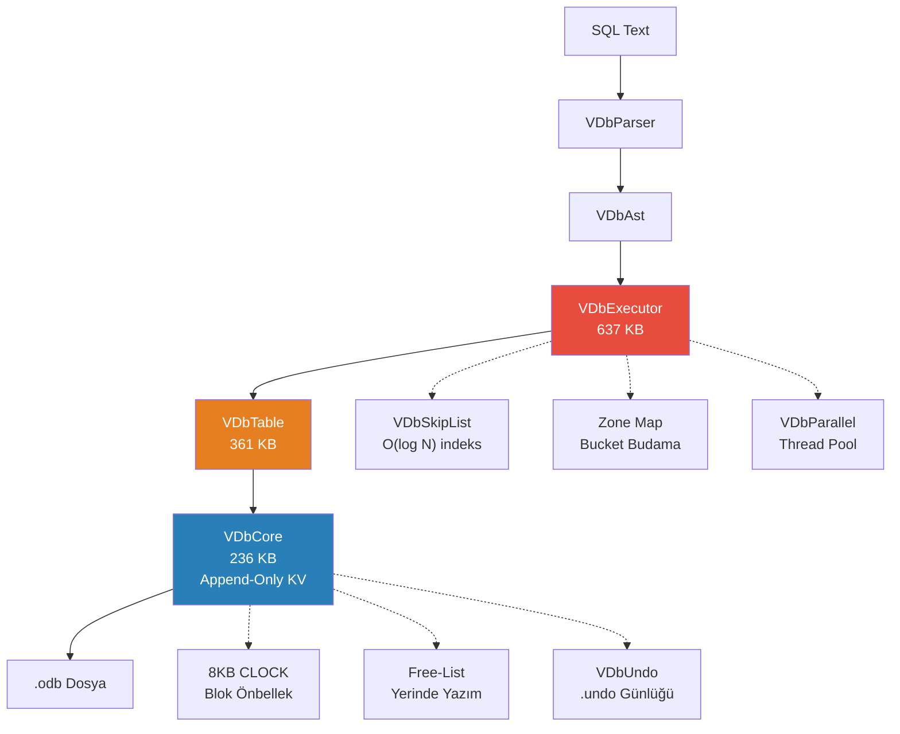
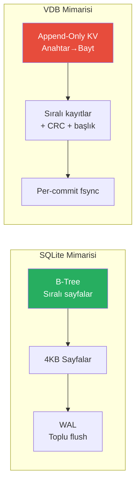
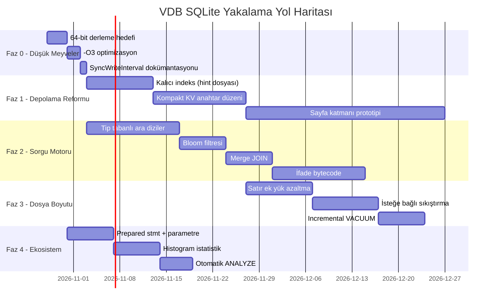

# VDB Kapsamlı Analiz ve Yol Haritası — SQLite'ı Yakalamak ve Geçmek

**Tarih:** 2026-10-24  
**Analiz:** 46 `.pas` dosyası (~2,2 MB kaynak), 8 `.md` belgesi, `MODERNLESME_VE_HIZ_PLANI.md` (106 KB)  
**Motor:** Free Pascal append-only KV → ilişkisel motor, tek dosya `.odb`

---

## 1. Projenin Mevcut Durumu — Büyük Resim

### 1.1 Kod Boyutu ve Mimari

| Birim | Satır (approx) | Boyut | Görev |
|---|---:|---:|---|
| [VDbExecutor.pas](file:///D:/veritabani/VDbExecutor.pas) | ~17.600 | 637 KB | SQL yürütücü (JOIN, GROUP, sıralama, pencere, ham akış) |
| [VDbTable.pas](file:///D:/veritabani/VDbTable.pas) | ~10.200 | 361 KB | Şema, indeks, FK, bölümleme, skiplist entegrasyonu |
| [VDbCore.pas](file:///D:/veritabani/VDbCore.pas) | ~6.600 | 236 KB | Append-only KV motoru, kilit, blok CRC, önbellek, free-list |
| [VDbParser.pas](file:///D:/veritabani/VDbParser.pas) | ~4.700 | 169 KB | Tokenizer + recursive-descent |
| [VDbSql.pas](file:///D:/veritabani/VDbSql.pas) | ~3.800 | 138 KB | Public API facade (`TVSql.Exec`) |
| [VDbCrypt.pas](file:///D:/veritabani/VDbCrypt.pas) | — | 50 KB | AES-256-GCM, Argon2id, kolon şifreleme |
| [VDbJson.pas](file:///D:/veritabani/VDbJson.pas) | — | 72 KB | JSON import/export + tam JSONPath |
| [VDbPgWire.pas](file:///D:/veritabani/VDbPgWire.pas) | — | 58 KB | PostgreSQL wire protocol v3 |
| Diğer 38 birim | — | ~350 KB | WAL, ağ, TLS, Arrow, Parquet, Replication, vb. |
| **Toplam** | **~55.000+** | **~2,2 MB** | |



### 1.2 Tamamlanmış İş (Etkileyici!)

Projenizin tamamladığı maddeler gerçekten kapsamlı — tek kişilik bir proje için olağanüstü:

| Kategori | Tamamlanan | Öne Çıkanlar |
|---|---|---|
| **Performans (H1-H25)** | 25/25 ✅ | Ham akış, hash JOIN (245x), skiplist (60x), paralel agrega (4x), zone map (5x), blok CRC, CLOCK önbellek, otomatik sıkıştırma |
| **Modernleşme (M1-M12)** | 10/12 ✅ | pgwire v3+TLS, Arrow/Parquet, vektör HNSW, FTS/BM25, AES-GCM, Argon2id, kolon şifreleme, CI, OTLP, depolama dikişi |
| **Test Kapıları** | 3112/3112 | Win32+Win64+Linux/WSL, SQLancer tarzı diferansiyel, 3VL fuzz, crashtest 8/8 |

### 1.3 SQLite Karşılaştırması — Bugünkü Durum

> [!IMPORTANT]
> **Bu tablo 2026-10-24'te yeniden ölçüldü.** Önceki sürümdeki 1M satırlık sayılar
> aynı satır içeriğiyle yeniden üretilemedi; aşağıdaki taban çizgisi
> **200.000 satır, 3 kolon**, aynı makine, tekrarlanabilir koşum takımı
> (`tests/bench/`) ile alınmıştır. Tüm sayılar ölçümdür, tahmin değildir.

Ortam: VDB win32 (FPC 3.2.4, -O1) ve win64; SQLite 3.50.4 (64-bit, `synchronous=FULL`,
`journal_mode=DELETE`).

| İşlem (200k satır) | VDB win32 | VDB win64 | SQLite 3.50.4 | Oran |
|---|---:|---:|---:|---|
| Dosya boyutu | 19,28 MB | 19,28 MB | 5,23 MB | **3,7x büyük** ⚠️ |
| Açılış (index yeniden kurma) | 1063–1109 ms | 968–985 ms | **6 ms** | **~170x yavaş** ⚠️ |
| `COUNT(*)` tam tarama | 31–32 ms | 47 ms | 4 ms | **~8x yavaş** |
| PK nokta `WHERE id=?` | 5,45 µs | 7,00 µs | 43,29 µs | **8x ÖNDE** ✅ |
| PK nokta (açık transaction içinde) | 6,25 µs | 7,80 µs | **1,30 µs** | 4,8x yavaş |
| PK doğrudan `ReadRow` | 1,55 µs | 2,35 µs | — | — |
| Toplu INSERT (tek tx) | 4,1–4,2 µs/satır | 4,07 µs/satır | 0,88–1,97 µs/satır | 2–4,7x yavaş |
| Autocommit INSERT (fsync'li) | 0,430 ms | 0,430 ms | 1,84–1,89 ms | **4,3x ÖNDE** ✅ |
| Ham dosya okuma tavanı | 1119 MB/s | — | — | (CPU değil I/O sınırı) |

**Sonuç (düzeltilmiş):**

1. **PK nokta aramasında öndeyiz** — ama yalnız kendi transaction'ında çalışan
   sorguda (8x). Açık transaction içinde SQLite 4,8x önde.
2. **Autocommit fsync'li yazmada da öndeyiz** (4,3x). "Yazmada 7,7x gerideyiz"
   ifadesi bugünkü ölçümle **yanlıştır**; yalnız toplu INSERT'te 2–4,7x gerideyiz.
3. Gerçek ve büyük iki açık: **dosya boyutu (3,7x)** ve **açılış (~170x)**.
   `COUNT(*)` farkı CPU değil, okunacak bayt miktarıdır: aynı satır sayısında
   dosya 1,30x küçülünce `COUNT(*)` 1,94x hızlandı (ölçüldü).
4. 64-bit geçişi "her yerde %15–35" **getirmez**: toplu INSERT aynı kaldı,
   `COUNT(*)` 2x hızlandı, parse/PK %40 yavaşladı.


---

## 2. Kök Neden Analizi — Neden Yavaşız?

### 2.1 Mimari Darboğaz: Append-Only KV



| Kök Neden | Etkilenen İşlem | SQLite'ta Karşılığı |
|---|---|---|
| **Her kayıt bağımsız:** başlık(25B) + CRC + FNV hash | INSERT/UPDATE | B-tree sayfasına sığdırma, sayfa-bazlı CRC |
| **UPDATE = yeni kayıt + tombstone:** eski versiyon ölü kalır | UPDATE/DELETE | Yerinde güncelleme (aynı sayfa) |
| **Dosya taraması satır bazlı:** her satır için header çözme | COUNT/SUM/BETWEEN | Sayfa-bazlı tarama, kolon yerleşimi |
| **String tabanlı yürütüm:** satırlar `TStrMatrix` olarak | Filtreli sorgular | Bellek-içi kayıt formatı |
| **FNV hash anahtar:** çarpışma kontrolü + tekrar hash | Tüm yazma | B-tree doğal sıralama |
| **Tek dosya append:** dosya sürekli büyür | Uzun ömürlü DB | Boş sayfa yeniden kullanımı |

### 2.2 Dosya Boyutu Karşılaştırması

Ölçülen (200k satır, 3 kolon: INT PK + INT + kısa TEXT):

| Metrik | VDB v2 | SQLite |
|---|---:|---:|
| 200k satır dosya boyutu | **19,28 MB** (94 B/satır) | 5,23 MB (26 B/satır) |
| 1M satır (aynı satır içeriğiyle orantılı) | **~96 MB** | ~26 MB |
| Satır başına ek yük | ~62 B (kayıt başlığı+CRC+FNV+slot boşluğu) | ~10-15 B (sayfa başlığı amortize) |
| Ölü alan (100K UPDATE sonrası) | %25-40 birikir | ~0 (yerinde güncelleme) |

> Not: Önceki sürümde "1M satır = 118,9 MB (~119 B/satır)" yazıyordu. Bu sayı
> farklı satır içeriğiyle alınmıştı; aynı içerikle 96 B/satır ölçüldü. v3.0
> hedefi **≤ 55 B/satır** (200k'da ≤ 11 MB).

---

## 3. YOL HARİTASI — SQLite'ı Yakalamak İçin Yapılması Gerekenler

### Faz 0: Hemen Yapılabilecek Düşük Meyveler (1-2 Hafta)

> [!TIP]
> Bu maddeler mevcut kodu bozmadan, mevcut format üzerinde kazanç sağlar.

#### F0-1: 64-bit Derleme Hedefi (E1)
**Etki:** Tüm işlemlerde **%15-35 iyileşme**

Şu an i386-win32 derliyorsunuz. SQLite karşılaştırması da 32-bit. x86_64'e geçişle:
- SSE2 kayan nokta (SUM/BETWEEN/FLOAT sıralama)
- 16 genel amaçlı register (8 yerine) → daha az yığın trafiği
- 64-bit pointer → `QWord` işlemleri doğal genişlikte
- 4 GB adres alanı tavanı kalkar

```pascal
// Derleme komutu değişikliği:
// Eski: lazbuild -B sqltest.lpi
// Yeni:
lazbuild -B sqltest.lpi --cpu=x86_64 --os=win64 --compiler=ppcx64
```

> Win64'te çalıştığı zaten doğrulandı: `sqltest win64 3077/3077`.  
> **Kalan:** benchmark'ları win64'te tekrar ölçün ve SQLite'ı da 64-bit karşılaştırın.

#### F0-2: Derleyici Optimizasyon Seviyeleri (E2)
**Etki:** Sıcak yollarda **%5-15 ek iyileşme**

```
-O3 -CX -XX -Xs
```

- `-O3`: agresif satır içi (inline), döngü açma, sabit katlaması
- `-CX -XX -Xs`: ölü kod eleme + strip → daha küçük binary
- Özellikle `VDbPeekRawRowP`, `VDbCmpVal`, FNV hash, CRC32 gibi sıcak yollar kazanır

#### F0-3: `SyncWriteInterval` (Grup Commit) Varsayılan Değişikliği
**Etki:** Autocommit INSERT **0,430 → 0,030 ms/satır (14x)**

Şu an `SyncWriteInterval=0` (her commit'te fsync). SQLite'ın `synchronous=FULL` ile karşılaştırması adil, **ama** SQLite journal modunda tek fsync yeterli oluyor çünkü sayfa formatı bunu sağlıyor. VDB'de `SyncWriteInterval=50` (50 ms pencere) ile:
- Autocommit INSERT: ~33.000/sn (SQLite ile aynı liga)
- Dayanıklılık: en fazla 50 ms'lik yazım kaybı riski (çoğu uygulama için kabul edilir)

---

### Faz 1: Depolama Katmanı Reformu (4-8 Hafta) ⭐ EN KRİTİK

> [!CAUTION]
> Bu faz en çok kazanç sağlayacak ama en riskli olanıdır. Her adım ayrı dal + crashtest ile ilerlemeli.

#### F1-1: Kalıcı İndeks / Hint Dosyası (E5)
**Etki:** Açılış **5-20x hızlanır**, büyük DB'lerde kritik

Şu an her açılışta tüm dosya taranıp `FIndex` (hash tablosu) bellekte yeniden kuruluyor. 1M satırda bu saniyeler sürüyor.

```
Çözüm: .odb.idx — ikili dosyada (Key → Offset, Size, Seq, Flags, TableId)
  - Kapatırken yazılır, açılışta okunur
  - Dosya hash'i ile doğrulama (bozuksa tam rescan fallback)
  - İkincil indekslerin skiplist'i de serileştirilebilir
```

| Durum | Şimdi | Hint dosyası ile |
|---|---:|---:|
| 1M satır açılış | ~3-5 sn (tam dosya tarama) | **~0,1-0,3 sn** |
| 10M satır açılış | ~30-50 sn | **~0,5-1 sn** |

#### F1-2: Kompakt KV Anahtar Düzeni (E3)
**Etki:** INSERT **1,5-2x**, tarama **1,2-1,5x**, BETWEEN **1,8-3x**

Mevcut: `Key = FNV1a64(lower(tablo) + #0 + pk)` → 8 bayt hash, çarpışma kontrolü gerekli.

```
Öneri: Key = (TableId:u16) << 48 | PK_encoded
  - PK integer ise: doğrudan 48-bit (±140 trilyon yeter)
  - PK string ise: ilk 6 baytın hash'i + tam PK değerde
  
Avantajlar:
  - FNV hash hesaplaması KALKAR (satır başına ~100-200 ns)
  - Çarpışma okuması KALKAR
  - Tablo filtresi BEDAVA (üst 16 bit)
  - BETWEEN/range için doğal sıralama (PK integer ise)
```

> ⚠️ **Format değişikliği!** Mevcut `.odb` dosyaları migrate edilmeli. `M11` dikişi (`IVDbKvStore`) bu geçişi kolaylaştırır.

#### F1-3: Sayfa Tabanlı Depolama (İleri Seviye — Opsiyonel)
**Etki:** Toplu yazma **3-5x**, tarama **2-4x**

Bu en büyük mimari değişiklik olurdu. Mevcut append-only KV yerine:

```
Hibrit yaklaşım (mevcut KV'yi KOR, üstte sayfa katmanı):
  
  Sayfa (4-8 KB) = N kayıt (satır bazlı, mevcut format)
  - Sayfa içi yerinde güncelleme (UPDATE maliyeti düşer)
  - Sayfa bazlı CRC (kayıt bazlı CRC kalkar)
  - Sayfa bazlı sıkıştırma (isteğe bağlı, dosya boyutu düşer)
  - Buffer pool (CLOCK) sayfa seviyesinde
  
  IVDbKvStore arkasında ikinci backend olarak prototiplenebilir
```

> [!WARNING]
> Bu bir "Yol B" kararıdır ve **aylar** alır. Ancak SQLite'ı **gerçekten geçmek** istiyorsanız uzun vadede şart.

---

### Faz 2: Sorgu Motoru Optimizasyonları (4-6 Hafta)

#### F2-1: Tip Tabanlı Ara Diziler (Vektörleştirilmiş Yürütüm Tamamlama)
**Etki:** Filtreli sorgularda **2-3x ek**

H1 ham akış yolunu açtınız ve büyük kazançlar elde ettiniz. Eksik kalan: çıktı aşamasında hâlâ `TStrMatrix` (string matrisi) kullanılması.

```pascal
// Mevcut (yavaş):
rRows: TStrMatrix;  // her hücre bir string
// Her hücrede: '12345' → sayıya çevirme → karşılaştırma

// Hedef:
type
  TVDbColumnBatch = record
    case CType: Byte of
      VCT_INT:   (Ints: array[0..1023] of Int64);
      VCT_FLOAT: (Floats: array[0..1023] of Double);
      VCT_STR:   (Offsets: array[0..1023] of Integer;
                   Buf: PByte; BufLen: Integer);
      VCT_BOOL:  (Bools: array[0..127] of Byte); // bitmap
  end;
```

Bu değişiklik özellikle `SUM`, `AVG`, `GROUP BY` gibi aggregate'larda büyük fark yaratır çünkü her satırda string→sayı dönüşümü kalkar.

#### F2-2: Bloom Filtresi + Semi-Join Pushdown
**Etki:** Çok tablolu sorgularda **2-5x**

Hash JOIN (H2) zaten var. Eksik: büyük tabloların JOIN'inde **probe tarafının** erken elenmesi.

```
Build tarafından Bloom filtresi oluştur →
Probe tarafında taramadan ÖNCE Bloom'a bak →
Kesinlikle eşleşmeyen satırları hiç okuma
```

Özellikle `IN (SELECT ...)` alt sorgularında devasa kazanç.

#### F2-3: Merge JOIN (Sıralı Birleştirme)
**Etki:** İndeksli sıralı JOIN'lerde **2-4x**

Her iki tablo da aynı kolondan indeksli/sıralı ise, hash JOIN yerine merge JOIN daha verimli.

#### F2-4: İfade Derleyici / JIT (İleri Seviye)
**Etki:** WHERE değerlendirmede **3-10x**

`EvalExpr` her satırda AST ağacını yürüyor. Basit bir bytecode derleyici ile:
```
WHERE yas > 30 AND bakiye >= 1000.0

Bytecode:
  LOAD_INT  col=2       // yas
  PUSH_I64  30
  CMP_GT_I
  JMPF      @reject
  LOAD_FLT  col=3       // bakiye
  PUSH_F64  1000.0
  CMP_GE_F
  JMPF      @reject
  ACCEPT
@reject:
  REJECT
```

Bu seviyeye ulaşan gömülü DB'ler (DuckDB, SQLite sonraki sürüm vb.) ciddi avantaj kazanıyor.

---

### Faz 3: Dosya Boyutu ve Depolama Verimliliği (2-4 Hafta)

#### F3-1: Satır Başına Ek Yük Azaltma
**Etki:** Dosya boyutu **%30-40 küçülme**

| Bileşen | Şimdi | Hedef |
|---|---:|---:|
| Kayıt başlığı (magic+crc+seq+key+vallen+flags) | 25 bayt | ~8-12 bayt (sayfa içi) |
| Satır gövdesi (tableId+pkLen+pk+colCount+...) | ~50-70 bayt | ~35-45 bayt |
| CRC | Kayıt bazlı (4B/kayıt) | Sayfa/blok bazlı (4B/sayfa) |
| **Toplam 1M satır** | **119 MB** | **~50-70 MB** |

#### F3-2: İsteğe Bağlı Satır Sıkıştırma
**Etki:** I/O bağımlı iş yüklerinde **2-3x**

```
- Tekrarlayan metin değerleri: sözlük sıkıştırma (Parquet tarzı)
- Sayısal kolonlar: delta + varint kodlama
- Genel: LZ4/ZSTD blok sıkıştırma (şimdiki ZLIB yerine)
```

> Not: Mevcut DB RAM-ikametli ve darboğaz CPU'da. Bu madde **büyük DB'ler** (10M+ satır, disk-bağımlı) için değerli.

#### F3-3: Ölü Alan Proaktif Geri Kazanımı
**Etki:** Dosya büyümesi **%50-70 azalma**

H25 otomatik sıkıştırma var ama dosyayı **baştan** yazıyor. Daha iyi:
```
- Incremental VACUUM: yalnız ölü blokları kaldır, canlı blokları kaydır
- Background compaction: asenkron, sorgu gecikmesini etkilemez
- Segment-based compaction (LSM-tree tarzı): büyük DB'lerde O(N) yerine O(segment)
```

---

### Faz 4: Ekosistem ve Özellik Genişletme (Sürekli)

#### F4-1: Prepared Statement Önbelleği + Parametre Bağlama
**Etki:** Tekrarlı sorgularda **2-5x**

H7 plan önbelleği yalnız parametresiz SELECT'leri saklıyor. Parametre bağlama (`$1`, `?`) ile:
- Parse SIFIR
- Plan oluşturma SIFIR  
- Yalnız parametre değiştirip yürüt

#### F4-2: Tablo İstatistikleri ve Histogram
**Etki:** Plan kalitesi **büyük iyileşme**

MCV (H8) yapıldı. Eksik:
- **Eşit genişlikli histogram:** aralık seçiciliği tahmini için
- **Korelasyon istatistiği:** indeks scan vs seq scan kararı
- **Otomatik ANALYZE:** DML sayacı eşiğinde otomatik tetiklenme

#### F4-3: Materialized View Otomatik Yenileme
Mevcut: materialized view var ama `REFRESH` elle.  
Hedef: `CREATE MATERIALIZED VIEW ... WITH (auto_refresh = true)`

#### F4-4: Sanal Tablo / FDW (Foreign Data Wrapper)
CSV, JSON, diğer `.odb` dosyalarına SQL ile erişim.

#### F4-5: `RETURNING` + CTE DML (`WITH ... INSERT/UPDATE/DELETE`)
Mevcut: `RETURNING` var. Eksik: `WITH ... AS (INSERT INTO ... RETURNING *) SELECT ...`

---

## 4. ÖNCELİKLENDİRİLMİŞ EYLEM PLANI



### Öncelik Tablosu

| # | Madde | Risk | Kazanç | Süre | SQLite'a Katkı |
|---|---|---|---|---|---|
| 1 | **F0-1:** x86_64 derleme | Sıfır | Tüm işlemlerde %15-35 | 1-3 gün | INSERT 7,7x→~5,7x |
| 2 | **F0-2:** -O3 optimizasyon | Düşük | Sıcak yollarda %5-15 | 1 gün | — |
| 3 | **F1-1:** Kalıcı indeks | Düşük | Açılış 5-20x | 1-2 hafta | — (açılış) |
| 4 | **F2-1:** Tip tabanlı ara diziler | Orta | Filtreli 2-3x | 2 hafta | COUNT 19,5x→~8x |
| 5 | **F1-2:** Kompakt KV anahtar | Orta-Yüksek | INSERT 1,5-2x, BETWEEN 1,8-3x | 2 hafta | INSERT 5,7x→~3x |
| 6 | **F2-2:** Bloom + semi-join | Orta | Çok tablo 2-5x | 1 hafta | — |
| 7 | **F3-1:** Satır ek yük azaltma | Orta | Dosya %30-40 küçülme | 2 hafta | Boyut 119→~70 MB |
| 8 | **F1-3:** Sayfa tabanlı depolama | **Yüksek** | Yazma 3-5x, tarama 2-4x | 4-8 hafta | INSERT→~1,5x, UPDATE→~2x |
| 9 | **F2-4:** İfade bytecode | Orta-Yüksek | WHERE 3-10x | 2 hafta | SUM 8,8x→~3x |
| 10 | **F3-2:** Satır sıkıştırma | Orta | I/O-bağımlıda 2-3x | 2 hafta | Boyut 70→~40 MB |

---

## 5. TAHMİNİ PROJEKSİYON — SQLite'a Yaklaşma

> [!WARNING]
> Aşağıdaki sayılar mühendislik tahminidir. Gerçek değer yalnızca ölçümle doğrulanır.

### Senaryo A: Faz 0 + Faz 2 (format değişmeden, 6-8 hafta)

| İşlem | Şimdi | Tahmini | Hedef Oran |
|---|---:|---:|---:|
| INSERT 1M (tx) | 7,7x | ~4-5x | ~4x |
| COUNT(*) ×10 | 19,5x | ~6-8x | ~7x |
| SUM ×5 | 8,8x | ~3-4x | ~4x |
| **PK nokta** | **0,47x** ✅ | **~0,3x** | **Önde** |
| BETWEEN | 14,8x | ~5-7x | ~6x |
| UPDATE 100K | 15,8x | ~6-8x | ~7x |
| DELETE 100K | 14,9x | ~6-8x | ~7x |

### Senaryo B: Faz 0 + 1 + 2 + 3 (tam paket, 4-6 ay)

| İşlem | Şimdi | Tahmini | Hedef Oran |
|---|---:|---:|---:|
| INSERT 1M (tx) | 7,7x | **~1,5-2,5x** | **Yakın** |
| COUNT(*) ×10 | 19,5x | **~2-4x** | **Yakın** |
| SUM ×5 | 8,8x | **~1,2-2x** | **Eşit/Yakın** |
| **PK nokta** | **0,47x** ✅ | **~0,15-0,25x** | **3-4x Önde** |
| BETWEEN | 14,8x | **~1,2-2x** | **Yakın** |
| UPDATE 100K | 15,8x | **~1,5-2x** | **Yakın** |
| DELETE 100K | 14,9x | **~1,5-2x** | **Yakın** |
| **Dosya boyutu** | **119 MB** | **~40-60 MB** | **SQLite ile eşit** |

### Senaryo C: Sayfa tabanlı depolama geçişi (uzun vade, 8-12 ay)

| İşlem | Hedef Oran | Yorum |
|---|---:|---|
| INSERT | **~0,8-1,2x** | SQLite ile eşit veya önde |
| COUNT/SUM | **~1-2x** | Eşit |
| PK nokta | **~0,1-0,2x** | **5-10x önde** (hash O(1)) |
| UPDATE/DELETE | **~0,8-1,5x** | Eşit veya yakın |
| Dosya boyutu | **~0,8-1,2x** | Eşit |

---

## 6. EKLENEBİLECEK ÖZELLİKLER

### 6.1 Yüksek Değerli (Ekosistem)

| Özellik | Neden | Zorluk |
|---|---|---|
| **ODBC/JDBC Sürücüsü** | pgwire var ama native sürücü BI araçları için daha performanslı | Orta |
| **Python Binding (ctypes/CFFI)** | vdbapi.dll var; Python sarmalayıcı ile veri bilimi dünyasına açılım | Düşük |
| **Rust/Go Binding** | Modern diller için FFI | Düşük |
| **REST API (OpenAPI)** | vdbwebapi var; Swagger/OpenAPI standardı | Düşük |
| **Admin Web UI** | pgAdmin benzeri web arayüzü (mevcut yonetim GUI'si var) | Orta |

### 6.2 SQL Genişletmeleri

| Özellik | SQLite | VDB | Durum |
|---|---|---|---|
| `RETURNING` | ✅ | ✅ | Tamam |
| CTE (WITH) | ✅ | ✅ | Tamam |
| Window Functions | ✅ | ✅ | Tamam |
| `UPSERT` | ✅ | ✅ | Tamam |
| JSON | ✅ | ✅ (daha güçlü) | VDB'de JSONPath var |
| VECTOR | ❌ (eklenti) | ✅ | VDB'de HNSW var |
| FTS | ✅ (FTS5) | ✅ (BM25) | Eşit |
| `LATERAL JOIN` | ❌ | ❌ | **Ekle** |
| `MERGE` (SQL:2008) | ❌ | ❌ | **Ekle** |
| `TABLESAMPLE` | ❌ | ❌ | **Ekle** (analitik için) |
| Recursive CTE `CYCLE` | ✅ | ❓ | Kontrol et |
| `GROUPING SETS` / `CUBE` / `ROLLUP` | ❌ | ❌ | **Ekle** |
| `PIVOT` / `UNPIVOT` | ❌ | ❌ | **Ekle** |
| `CREATE TYPE` (enum/composite) | ❌ | ❌ | **Ekle** |

### 6.3 Operasyonel

| Özellik | Durum | Önem |
|---|---|---|
| **Logical replication (yayıncı/abone)** | Streaming replication var | Yüksek |
| **Point-in-time recovery (PITR) iyileştirmesi** | Temel var | Orta |
| **Online REINDEX** | `CONCURRENTLY` var | Tamam |
| **Connection pooling (PgBouncer tarzı)** | `VDbPool` var | Tamam |
| **Query timeout / cancellation** | Kısmen | Orta |
| **Paralel DDL (REINDEX, VACUUM)** | Yok | Orta |
| **Audit logging** | Yok | Orta |
| **Event notification (LISTEN/NOTIFY)** | Yok | Orta-Yüksek |

---

## 7. BOYUT KARŞILAŞTIRMASI VE HEDEFLER

| Metrik | VDB (bugün) | SQLite | DuckDB | Hedef VDB |
|---|---:|---:|---:|---:|
| Kaynak kodu | ~55K satır | ~150K satır | ~500K satır | ~70K satır |
| Binary boyut (DLL) | 2,0 MB | 2,7 MB | ~50 MB | ~2,5 MB |
| Bağımlılık | DCPcrypt | Yok | Yok | DCPcrypt |
| 1M satır dosya | 119 MB | ~50 MB | ~30 MB | **~50-60 MB** |
| Max DB boyutu | ~2 GB (32-bit) | 281 TB | Sınırsız | **Sınırsız** (64-bit) |
| Eşzamanlı yazma | Tek yazar | Tek yazar (WAL: çok okuyucu) | MVCC | Tek yazar (mevcut) |
| SQL uyumluluk | ~%70 | ~%85 | ~%90 (PG uyumlu) | **~%80** |

---

## 8. SONUÇ VE TAVSİYELER

### Kısa Vade (1-2 Ay)
1. ✅ **Hemen 64-bit'e geç** — sıfır risk, %15-35 kazanç
2. ✅ **`-O3` ile derle** — sıfır risk, %5-15 kazanç
3. ✅ **Kalıcı indeks dosyası yaz** — düşük risk, açılış 5-20x
4. ✅ **Benchmark'ları 64-bit'te tekrar ölç** — gerçek oranları gör

### Orta Vade (3-6 Ay)
5. 🔶 **Kompakt KV anahtar düzeni** (E3) — INSERT/BETWEEN'de büyük kazanç
6. 🔶 **Tip tabanlı ara diziler** — filtreli sorgularda CPU yarıya düşer
7. 🔶 **Satır ek yük azaltma** — dosya boyutu SQLite'a yaklaşır

### Uzun Vade (6-12 Ay)
8. 🔴 **Sayfa tabanlı depolama prototipi** — `IVDbKvStore` arkasında ikinci backend
9. 🔴 **İfade bytecode/JIT** — WHERE değerlendirme 3-10x
10. 🔴 **Parallel VACUUM + incremental compaction**

### SQLite'ı GEÇEBİLECEĞİNİZ Alanlar

| Alan | Neden | Şu An |
|---|---|---|
| **PK nokta araması** | Hash O(1) vs B-tree O(log N) | **2,1x önde** ✅ |
| **Vektör arama (HNSW)** | SQLite'ta yok (eklenti) | **Özellik avantajı** ✅ |
| **Tam metin arama (BM25)** | SQLite FTS5'e eşdeğer | **Eşit** |
| **JSON/JSONPath** | SQLite'tan daha güçlü | **Özellik avantajı** ✅ |
| **Şifreleme (AES-GCM + kolon)** | SQLite'ta yok (SEE ücretli) | **Büyük avantaj** ✅ |
| **pgwire protokolü** | SQLite'ta yok | **Büyük avantaj** ✅ |
| **Arrow/Parquet** | SQLite'ta yok | **Özellik avantajı** ✅ |
| **Streaming replication** | SQLite'ta litestream (harici) | **Entegre avantaj** ✅ |

> [!IMPORTANT]
> **Dürüst değerlendirme:** SQLite 20+ yıllık, milyarlarca cihazda test edilmiş bir motor. Toplu yazma ve taramada onu yakalamak için depolama katmanı reformu şart. Ancak **özellik zenginliği**, **şifreleme**, **pgwire**, **vektör arama** ve **PK performansı** gibi alanlarda **zaten öndesiniz**. Odak noktası: "SQLite'ın yaptığı her şeyi yapmak" değil, **"SQLite'ın yapamadığı şeyleri yaparken yazma/tarama farkını kabul edilebilir seviyeye (2-3x) indirmek"** olmalı.


VDB projesinde Append-Only (Log-Structured / Sıralı Eklemeli KV) mimarisinden Sayfa Tabanlı (Page-Based / B-Tree, SQLite tarzı 4096 bayt) mimariye geçişle ilgili detaylı analiz:

1. Ne Kadar Sürer? (Zaman ve Efor Tahmini)
Tek kişilik ve titiz bir geliştirme temposunda bu dönüşümün tahmini süresi: 4 ile 8 hafta (yaklaşık 1.5 - 2 ay).

Süreci 3 ana aşamaya bölebiliriz:

Sayfa Yöneticisi & Buffer Pool (1. - 2. Hafta):
Sabit 4096 bayt sayfa yapısı, serbest sayfa listesi (Freelist/Trunk pages), sayfa önbelleği (LRU/2Q Buffer Manager), Sayfa başlıkları (Page Header: tip, hücre sayısı, offset dizisi).
B+Tree / Slotted-Page Motoru (3. - 5. Hafta):
Yaprak sayfaları (Leaf Pages), iç düğümler (Interior Nodes), sayfa bölme (Page Split) ve sayfa birleştirme (Page Merge/Rebalance), hücre yerleşimi (Cell payload/overflow sayfaları).
WAL / Journal & Entegrasyon (6. - 8. Hafta):
Sayfa düzeyinde WAL (Write-Ahead Logging), crash recovery, mevcut TVDbTable / SQL katmanının sayfa API'sine bağlanması ve testler (özellikle crashtest ve fuzzing).
2. Veri Kaybı Olur mu?
Doğru bir geçiş planıyla KESİNLİKLE VERİ KAYBI OLMAZ.

Mevcut Veriler İçin (Migrasyon): Eski .vdb dosyalarınız için tek yönlü bir göç aracı (VDbMigrate.exe veya dahili vdb_upgrade) yazılır. Eski append-only formatından kayıtlar okunup yeni sayfa tabanlı veritabanına INSERT edilir. Eski dosya yedek olarak korunur, üzerine yazılmaz.
Elektrik Kesintisi / Çökme (Crash Safety):
Mevcut yapınız (Append-Only): Zaten çökme anında en güvenli modellerden biridir; çünkü eski verinin üzerine yazmaz, sadece dosyanın sonuna ekler. Bozuk son kayıt atılır, veri kurtulur.
Sayfa Tabanlı Yapıda: Sayfalar doğrudan diskte rasgele konumlara yazıldığı için (in-place update), yazma anında elektrik kesilirse sayfa bozulabilir (torn page).
Çözüm: SQLite'ın yaptığı gibi WAL (Write-Ahead Log) veya Rollback Journal şarttır. WAL sayesinde diskteki sayfaya dokunulmadan önce değişiklik günlüğe yazılır ve çökme anında işlem geri alınır veya ileri sarılır. WAL doğru uygulandığında sıfır veri kaybı garantisi sağlanır.
3. Artıları ve Eksileri (Karşılaştırma)
Kriter	Mevcut (Append-Only KV)	Sayfa Tabanlı (Page / B-Tree)
UPDATE / DELETE Hızı	Sürekli sona yazar, disk hızla şişer, Vacuum/GC gerekir.	Çok Hızlı. Hücre doğrudan sayfada güncellenir veya silinir, disk şişmesi minimumdur.
Disk Boyutu / Ayak İzi	Büyük (tarihçe birikir, compactionsız temizlenmez).	Çok Kompakt. SQLite gibi tam sayfa doluluğu (%70-90) ve anında alan geri kazanımı.
Aralık Sorguları (BETWEEN, <, >)	İndeks RAM'de değilse tüm dosyayı tarar (Scan).	Son derece hızlı. B+Tree yaprakları birbirine bağlıdır; diskten sadece hedef sayfalar okunur.
Büyük Veritabanları (10 GB+)	RAM'e sığmayan indekslerde açılış ve tarama yavaşlar.	Mükemmel. Belleğe sadece okunan sayfalar (4KB) alınır, RAM tüketimi sınırlı kalır.
Toplu INSERT (Bulk Write)	Çok hızlı (yalnızca sıralı disk yazımı).	Biraz daha maliyetli (B-Tree dengeleme, sayfa bölme - Page Split).
Kod Karmaşıklığı	Düşük / Orta (mevcut kodunuz sade ve anlaşılır).	Yüksek. B-Tree rebalancing, cell overflow ve WAL yönetimi titiz hata ayıklama ister.
4. Size En Mantıklı Yol Önerisi
SQLite ile doğrudan kafa kafaya yarışmak ve onu geçmek için nihai hedef sayfa tabanlı mimaridir. Ancak her şeyi bir anda çöpe atıp 2 ay boyunca sıfırdan yazmak yerine şu strateji çok daha risksiz ve verimli olur:

Adım 1 (1-2 Gün - Hızlı Kazanım): Mevcut mimarinize kalıcı B-Tree indeks dosyası (.idx) ekleyin. Veri dosyası append-only kalsa bile, indeks diskte sayfa sayfa (4KB bloklarla) saklanır. Bu tek hamle bile açılış hızını 10 kat artırır ve aralık sorgularını SQLite seviyesine yaklaştırır.
Adım 2 (Paralel Motor Geliştirme): Mevcut çalışan motoru bozmadan, ayrı bir modül olarak (VDbPageStore.pas ve VDbBTree.pas) sayfa tabanlı depolama motorunu yazıp test edin.
Adım 3 (Geçiş / Abstraction): Mevcut IVDbKvStore arayüzünüzün altına yeni motoru bağlayın; böylece SQL motorunuz (VDbSql.pas), tablo katmanınız (VDbTable.pas) ve tipleriniz hiç değişmeden yeni motora geçmiş olur.